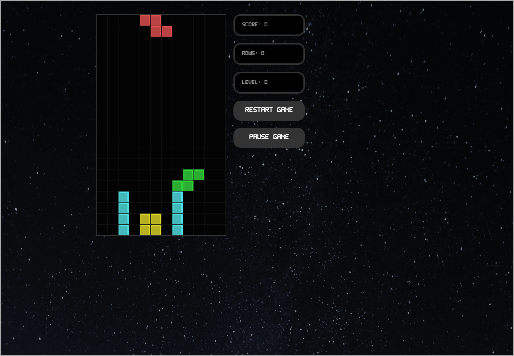

# React Tetris

[](https://github.com/einnor/react-tetris/actions/workflows/ci.yml)

A falling-block game built with **React 19, strict TypeScript, Vite and styled-components**. The game rules run in a deterministic, framework-independent engine; React owns rendering, input and a single gravity clock.



## Try it locally

Requires Node.js 24 and npm. No account, API keys or backend.

```sh
git clone https://github.com/einnor/react-tetris.git
cd react-tetris
npm ci
npm start
```

Open the localhost URL printed by Vite, then select **Start Game**. The game receives keyboard focus automatically.

| Key | Action |
| --- | --- |
| Left / right | Move the active piece |
| Up | Rotate clockwise, with horizontal collision adjustment |
| Down | Soft drop without disabling gravity |
| Space | Hard drop and lock the active piece |
| P | Pause or resume |
| Escape | Pause |
| Start Game | Start or reset the board, score and level |

The game pauses when focus leaves the game, its browser window loses focus, or the document becomes hidden. Returning does not silently restart gravity: choose **Resume game** or press **P**. Narrow layouts provide on-screen move/rotate/drop buttons.

## Engineering walkthrough

- `src/game/engine.ts` owns pure, atomic transitions: movement, rotation, locking, row clearing, scoring, spawning and terminal state.
- The settled board and active piece are separate. Rendering projects the active piece without mutating the board.
- A lock clears rows, scores at the pre-clear level and checks the next spawn in one transition. Level is derived from total rows, not maintained by another effect.
- `useGame` adapts reducer state to React and owns the gravity interval. Soft dropping never disables gravity or depends on receiving a later key-up event.
- Random state is explicit. Add `?seed=12345` to the URL for a reproducible round; the same seed and action sequence produce the same state. Invalid seeds fall back to a newly generated round seed.

The UI and game rules are deliberately kept separate enough to exercise collision and state regressions without a browser. This is a compact hook-based implementation, not a complete implementation of the official Tetris rules.

## Verification

```sh
npm test
npm run typecheck
npm run build
npm run preview
```

Vitest and Testing Library cover collision boundaries, single-to-four-line clears, scoring across level changes, immutable snapshots, blocked spawning, rotation, seeded replay, keyboard focus and Strict Mode timer ownership. GitHub Actions runs tests and a strict production build on Node.js 24. Vite emits a static site in `dist/`; the relative asset base also supports subdirectory hosting.

## Scope and trade-offs

No backend, persistence or analytics: game state lives entirely in memory and reloading loses the current round. Keyboard and narrow-screen button controls are supported. Rotation uses horizontal collision adjustment, not the official rotation system; there is no next-piece preview, seven-piece bag, hold mechanic, lock delay or competitive scoring service. Replay seeds reproduce piece generation; reproducing an entire round also requires the same timed action sequence. The original visual assets and learning-project identity are preserved rather than presenting this as a commercial game.

The screenshot above was captured from the running app with real keyboard input, without injected game state. Older screenshots remain in `screenshots/` as historical assets.

Tetris is a trademark of its respective owners; this personal learning project is unaffiliated.
